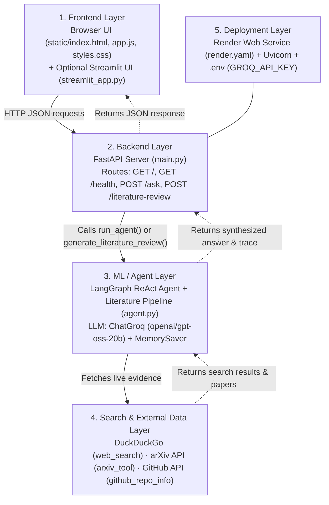
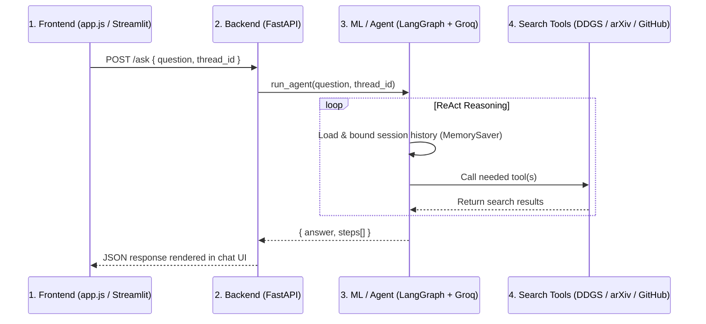
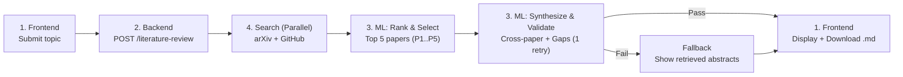

# ResearchOS — Agentic Research Assistant

An **agentic AI research assistant** built with **FastAPI**, **LangGraph**, and **Groq**. It supports two core workflows:
1. **Conversational Research Assistant (`POST /ask`)**: A LangGraph ReAct agent that decides when to answer directly or call external research tools (DuckDuckGo web search, arXiv paper search, and GitHub repository lookup), while preserving per-session conversational memory.
2. **Literature Review Generator (`POST /literature-review`)**: A source-grounded pipeline that retrieves arXiv papers and GitHub repositories concurrently, ranks up to five papers, synthesizes cross-paper interpretation and candidate research gaps with validation checks, and exports the result as Markdown.

---

## System Architecture

The project is organized into **5 sequential layers** from what the user sees in the browser down to where it is hosted:

```text
1. Frontend (UI)  ──▶  2. Backend (API)  ──▶  3. ML / Agent  ──▶  4. Search & Tools  ──▶  5. Deployment
```



### Layer-by-Layer Walkthrough (In Order)

#### 1. Frontend Layer (`static/` & `streamlit_app.py`)
- **What it does:** Gives the user a chat box to ask research questions and a form to generate literature reviews.
- **Main Web UI:** Served at `http://localhost:8000` using [static/index.html](file:///d:/Aryan/researchOS/Research_Atelier/static/index.html), [static/app.js](file:///d:/Aryan/researchOS/Research_Atelier/static/app.js), [static/styles.css](file:///d:/Aryan/researchOS/Research_Atelier/static/styles.css), and [static/review_markdown.js](file:///d:/Aryan/researchOS/Research_Atelier/static/review_markdown.js) (which handles Markdown export).
- **Session & Theme:** [static/app.js](file:///d:/Aryan/researchOS/Research_Atelier/static/app.js) saves a `threadId` in `sessionStorage` for multi-turn memory and light/dark theme preference in `localStorage`.
- **Optional Fallback UI:** [streamlit_app.py](file:///d:/Aryan/researchOS/Research_Atelier/streamlit_app.py) (styled with [theme_tokens.py](file:///d:/Aryan/researchOS/Research_Atelier/theme_tokens.py)) runs on `http://localhost:8501` and forwards questions to the FastAPI backend.

#### 2. Backend Layer (`main.py`)
- **What it does:** Acts as the traffic controller between the UI and the AI agent.
- **Validation & Routing:** [main.py](file:///d:/Aryan/researchOS/Research_Atelier/main.py) uses FastAPI and Pydantic schemas (`QuestionRequest`, `AnswerResponse`, `LiteratureReviewRequest`) to validate inputs and expose:
  - `GET /` — serves the browser UI (`static/index.html`)
  - `GET /health` — health check for local monitoring and Render
  - `POST /ask` — runs the conversational research agent
  - `POST /literature-review` — runs the structured literature review pipeline
  - `GET /docs` — interactive Swagger API documentation

#### 3. ML / Agent Layer (`agent.py`)
- **What it does:** Understands the user's request, decides which sources to query, and writes the final response.
- **LLM:** Uses **Groq** (`ChatGroq` with `openai/gpt-oss-20b`) configured via `GROQ_API_KEY`.
- **Chat Agent (`run_agent`):** A LangGraph ReAct agent (`create_react_agent`) that thinks in a loop (*Reason → Call Tool → Observe → Answer*). It includes:
  - `MemorySaver` to remember previous turns per `thread_id`
  - History bounding (keeps up to 6 turns / 6,500 chars) and thread locks
  - Safety hooks to repair interrupted tool calls and stop repeated tool loops
- **Literature Review Pipeline (`generate_literature_review`):**
  - Fetches arXiv papers and GitHub repos in parallel (`ThreadPoolExecutor`)
  - Ranks and selects up to 5 papers (`[P1]`–`[P5]`)
  - Prompts the LLM for `## Cross-paper interpretation` and `## Candidate research gaps`, validates citations/claims (with 1 retry), and falls back to displaying raw abstracts if validation fails.

#### 4. Search & External Data Layer
- **What it does:** Grounds the LLM in real, up-to-date external information instead of relying only on model memory.
- **3 Tools used by the agent:**
  - `web_search` — DuckDuckGo (`ddgs`) for current web facts and articles (no API key needed)
  - `arxiv_tool` — arXiv REST API (`arxiv`) for academic preprints and abstracts
  - `github_repo_info` — GitHub Public REST API (`api.github.com`) for repository stats, language, and license

#### 5. Deployment & Testing Layer (`render.yaml`, `requirements.txt`, `tests/`)
- **Hosting:** [render.yaml](file:///d:/Aryan/researchOS/Research_Atelier/render.yaml) configures Render to install [requirements.txt](file:///d:/Aryan/researchOS/Research_Atelier/requirements.txt), run `uvicorn main:app --host 0.0.0.0 --port $PORT` on Python `3.13.5`, monitor `/health`, and inject `GROQ_API_KEY`.
- **Testing:** [tests/](tests/) contains offline unit tests for both the Python backend (`unittest`) and frontend JS logic.

---

### How a Request Flows End-to-End

#### Flow A: Asking a Question (`POST /ask`)



#### Flow B: Generating a Literature Review (`POST /literature-review`)



---

## Agent Tools

1. **`web_search`** (DuckDuckGo via `ddgs`): Searches the open web for current events, facts, and general research without requiring an API key.
2. **`arxiv_tool`** (arXiv REST API via `arxiv`): Searches arXiv for academic preprints and papers across CS, physics, math, quantitative biology, and related fields.
3. **`github_repo_info`** (GitHub Public REST API): Fetches repository metadata (stars, forks, open issues, description, primary language, license, URL) for `owner/repo` inputs without authentication.

---

## Project Structure

```text
Research_Atelier/
├── main.py                              # FastAPI backend & static UI host
├── agent.py                             # LangGraph ReAct agent, tools & literature review pipeline
├── streamlit_app.py                     # Optional Streamlit UI (connects to FastAPI)
├── theme_tokens.py                      # Design tokens for Streamlit UI
├── requirements.txt                     # Python dependencies
├── render.yaml                          # Render deployment blueprint
├── .env                                 # Local environment variables (GROQ_API_KEY) — not committed
├── .streamlit/
│   └── config.toml                      # Streamlit configuration
├── static/
│   ├── index.html                       # ResearchOS web UI
│   ├── app.js                           # Browser-side chat, review UI & theme logic
│   ├── review_markdown.js               # Literature review normalization & Markdown export
│   └── styles.css                       # Light/dark theme styles
└── tests/
    ├── test_agent_runtime.py
    ├── test_chat_completion.py
    ├── test_literature_review.py
    ├── test_chat_frontend.js
    ├── test_literature_review_render.js
    └── test_review_markdown.js
```

---

## Setup & Run Locally

### 1. Enter the project directory
```powershell
cd d:\Aryan\researchOS\Research_Atelier
```

### 2. Create & activate a virtual environment
```powershell
python -m venv venv

# Windows (PowerShell)
venv\Scripts\activate

# macOS/Linux
source venv/bin/activate
```

### 3. Install dependencies
```powershell
pip install -r requirements.txt
```

### 4. Configure your Groq API key
Create a `.env` file in the project root (`Research_Atelier/.env`) with your Groq API key (get one at https://console.groq.com/keys):
```env
GROQ_API_KEY=your_groq_api_key_here
```

### 5. Start the FastAPI backend & web UI
```powershell
uvicorn main:app --reload
```
- **Web UI:** `http://localhost:8000`
- **Swagger API Docs:** `http://localhost:8000/docs`
- **Health Check:** `http://localhost:8000/health`

### 6. (Optional) Start the Streamlit fallback UI
In a **second terminal** (with `venv` activated and `uvicorn` running):
```powershell
streamlit run streamlit_app.py
```
Opens at `http://localhost:8501`.

### 7. Run offline tests
```powershell
python -m unittest discover -s tests
```
