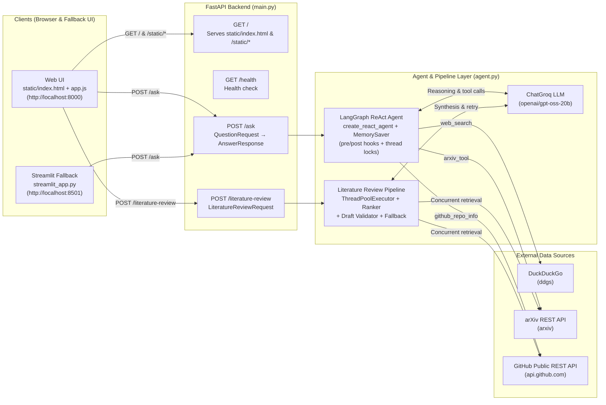
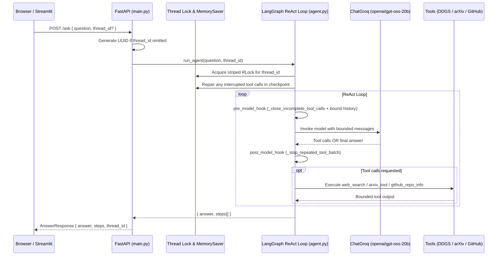
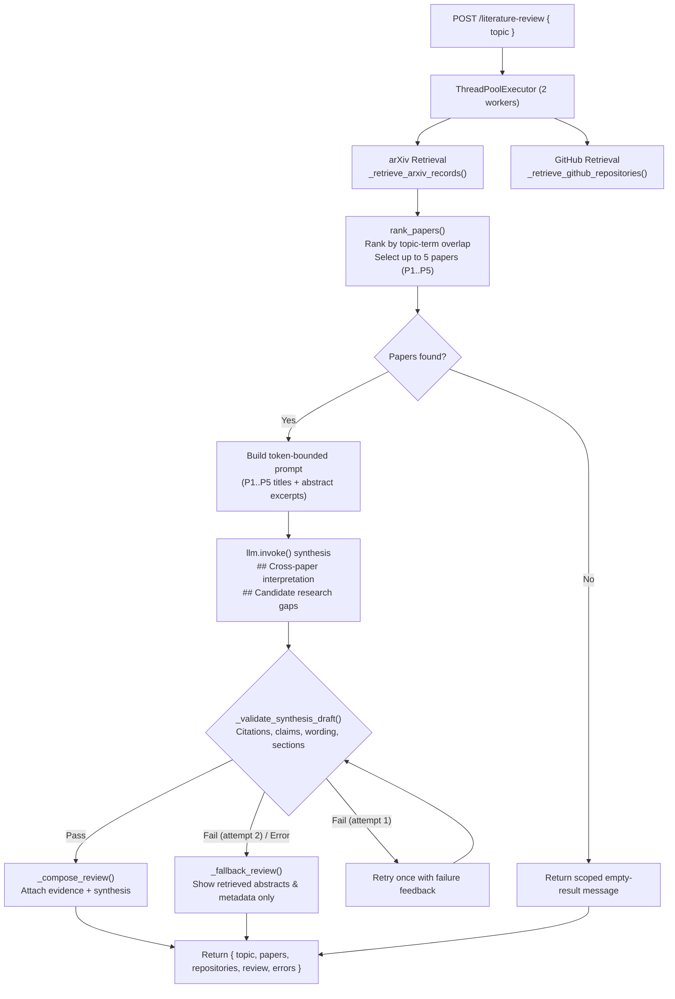

# ResearchOS — Agentic Research Assistant

An **agentic AI research assistant** built with **FastAPI**, **LangGraph**, and **Groq**. It supports two core workflows:
1. **Conversational Research Assistant (`POST /ask`)**: A LangGraph ReAct agent that decides when to answer directly or call external research tools (DuckDuckGo web search, arXiv paper search, and GitHub repository lookup), while preserving per-session conversational memory.
2. **Literature Review Generator (`POST /literature-review`)**: A source-grounded pipeline that retrieves arXiv papers and GitHub repositories concurrently, ranks up to five papers, synthesizes cross-paper interpretation and candidate research gaps with validation checks, and exports the result as Markdown.

---

## System Architecture

### High-Level Component Diagram



---

### Request Flow 1: Conversational Research (`POST /ask`)



#### Key Reliability & Memory Mechanisms (`agent.py`)
- **Session Memory (`MemorySaver`)**: Each browser tab stores a `threadId` in `sessionStorage` (or `st.session_state.thread_id` in Streamlit) and sends it with every `/ask` request so follow-up questions retain context.
- **Striped Thread Locking (`_THREAD_LOCKS`)**: 64 `RLock`s serialize concurrent requests sharing the same `thread_id` without blocking unrelated sessions.
- **History Bounding (`_bound_chat_history`)**: Keeps up to `CHAT_HISTORY_MAX_TURNS` (6) turns within `CHAT_HISTORY_MAX_CHARS` (6,500 chars), shortening older tool results (`CHAT_TOOL_RESULT_MAX_CHARS = 600`) when needed.
- **Checkpoint Repair (`_close_incomplete_tool_calls` / `_repair_incomplete_tool_history`)**: If a previous run was interrupted mid-tool-batch, unanswered tool calls are closed with explicit error `ToolMessage`s and duplicate tool messages are stripped so the graph can resume cleanly.
- **Loop Guard (`_stop_repeated_tool_batch`)**: Detects identical `(tool, args)` calls repeated within the same turn and stops the loop so the agent answers from collected evidence.

---

### Request Flow 2: Literature Review Generator (`POST /literature-review`)



- **Evidence vs. Interpretation Separation**: Retrieved paper abstracts and metadata are returned directly; the LLM only writes `## Cross-paper interpretation` and `## Candidate research gaps` using supplied citation IDs (`[P1]`–`[P5]`).
- **GitHub Context**: GitHub results represent related topic-search repositories unless an explicit paper-to-repository link is evidenced.
- **Markdown Export**: `static/review_markdown.js` normalizes the payload and formats a downloadable `.md` report.

---

## Layer Breakdown

| Layer | File(s) | Responsibility |
|---|---|---|
| **Web Frontend** | [static/index.html](static/index.html), [static/app.js](static/app.js), [static/review_markdown.js](static/review_markdown.js), [static/styles.css](static/styles.css) | Browser UI for research chat (`/ask`), Literature Review Generator (`/literature-review`), light/dark theme persistence, sanitized Markdown rendering (`marked` + `DOMPurify`), and `.md` download |
| **Fallback UI** | [streamlit_app.py](streamlit_app.py), [theme_tokens.py](theme_tokens.py), [.streamlit/config.toml](.streamlit/config.toml) | Optional Streamlit frontend that sends `/ask` requests to `http://localhost:8000` |
| **API Server** | [main.py](main.py) | FastAPI app, request/response Pydantic validation, request timing middleware, static file serving, `/health`, `/ask`, `/literature-review`, and Swagger `/docs` |
| **Agent & Pipelines** | [agent.py](agent.py) | `ChatGroq` LLM setup, LangGraph `create_react_agent`, `web_search` / `arxiv_tool` / `github_repo_info` tools, memory & loop guardrails, and the literature review pipeline |
| **Tests** | [tests/](tests/) | Offline Python `unittest` suites (`test_agent_runtime.py`, `test_chat_completion.py`, `test_literature_review.py`) and frontend JS tests (`test_chat_frontend.js`, `test_literature_review_render.js`, `test_review_markdown.js`) |
| **Deployment** | [render.yaml](render.yaml), [requirements.txt](requirements.txt) | Render web service configuration (`uvicorn main:app --host 0.0.0.0 --port $PORT`) and Python dependencies |

---

## Agent Tools

1. **`web_search`** (DuckDuckGo via `ddgs`): Searches the open web for current events, facts, and general research without requiring an API key.
2. **`arxiv_tool`** (arXiv REST API via `arxiv`): Searches arXiv for academic preprints and papers across CS, physics, math, quantitative biology, and related fields.
3. **`github_repo_info`** (GitHub Public REST API): Fetches repository metadata (stars, forks, open issues, description, primary language, license, URL) for `owner/repo` inputs without authentication.

---

## Project Structure

```text
Research_Atelier/
├── main.py                              # FastAPI backend & static UI host
├── agent.py                             # LangGraph ReAct agent, tools & literature review pipeline
├── streamlit_app.py                     # Optional Streamlit UI (connects to FastAPI)
├── theme_tokens.py                      # Design tokens for Streamlit UI
├── requirements.txt                     # Python dependencies
├── render.yaml                          # Render deployment blueprint
├── .env                                 # Local environment variables (GROQ_API_KEY) — not committed
├── .streamlit/
│   └── config.toml                      # Streamlit configuration
├── static/
│   ├── index.html                       # ResearchOS web UI
│   ├── app.js                           # Browser-side chat, review UI & theme logic
│   ├── review_markdown.js               # Literature review normalization & Markdown export
│   └── styles.css                       # Light/dark theme styles
└── tests/
    ├── test_agent_runtime.py
    ├── test_chat_completion.py
    ├── test_literature_review.py
    ├── test_chat_frontend.js
    ├── test_literature_review_render.js
    └── test_review_markdown.js
```

---

## Setup & Run Locally

### 1. Enter the project directory
```powershell
cd d:\Aryan\researchOS\Research_Atelier
```

### 2. Create & activate a virtual environment
```powershell
python -m venv venv

# Windows (PowerShell)
venv\Scripts\activate

# macOS/Linux
source venv/bin/activate
```

### 3. Install dependencies
```powershell
pip install -r requirements.txt
```

### 4. Configure your Groq API key
Create a `.env` file in the project root (`Research_Atelier/.env`) with your Groq API key (get one at https://console.groq.com/keys):
```env
GROQ_API_KEY=your_groq_api_key_here
```

### 5. Start the FastAPI backend & web UI
```powershell
uvicorn main:app --reload
```
- **Web UI:** `http://localhost:8000`
- **Swagger API Docs:** `http://localhost:8000/docs`
- **Health Check:** `http://localhost:8000/health`

### 6. (Optional) Start the Streamlit fallback UI
In a **second terminal** (with `venv` activated and `uvicorn` running):
```powershell
streamlit run streamlit_app.py
```
Opens at `http://localhost:8501`.

### 7. Run offline tests
```powershell
python -m unittest discover -s tests
```
